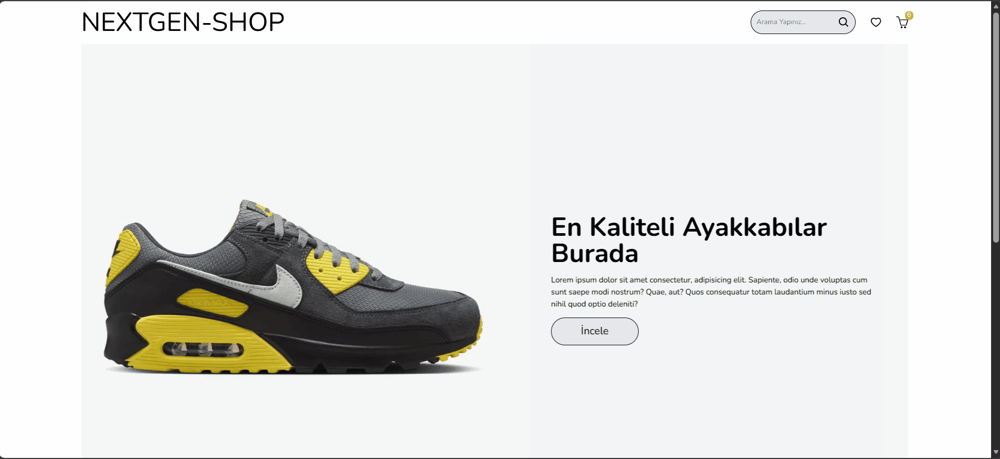

# 🛍️ NextGen-Shop

NextGen-Shop is a modern and responsive e-commerce application built with **React, Redux Toolkit, and TailwindCSS**. It allows users to explore products, filter by category, sort by price, view product details, and manage their shopping cart.

---

## 📌 Project Overview

This project was developed to practice modern React architecture, global state management with Redux Toolkit, client-side routing, and REST API integration.

### ✨ Key Features

- Product and category data integration with FakeStore API
- Global state management using Redux Toolkit
- Dynamic routing with React Router DOM
- Category-based filtering and price sorting
- Product detail pages
- Shopping cart management (add, remove, total price)
- Persistent cart data using LocalStorage
- Product pagination with React Paginate
- Interactive homepage slider
- Reusable React components
- Modern and responsive user interface

---

## 🛠️ Technologies Used

- **React** – Component-based UI development
- **Redux Toolkit & React Redux** – State management
- **React Router DOM** – Page navigation
- **TailwindCSS** – Responsive styling
- **Vite** – Development and build tool
- **JavaScript (ES6+)** – Application logic
- **FakeStore API** – Product data integration
- **React Icons** – UI icons
- **React Slick** – Image slider
- **React Paginate** – Product pagination

---

## 📸 Preview

